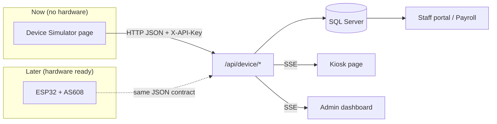
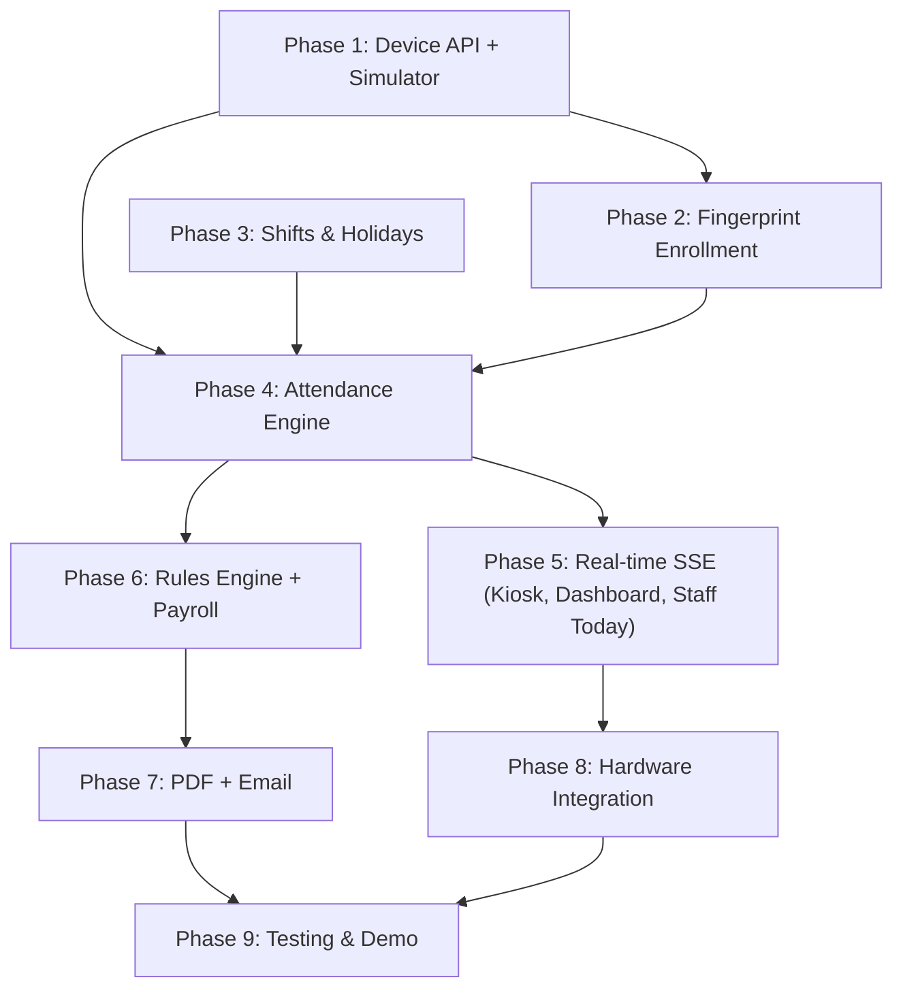

# Project Roadmap: Build Everything Before the Hardware Arrives

## Goal

Sprint 1 (user management) is done. The ESP32 + AS608 device isn't built yet. The SRS needs that device for scanning, enrollment, the kiosk, attendance, and therefore payroll.

**Strategy:** "Software first, hardware last." From the server's point of view, the ESP32 is just an **HTTP client that sends JSON**. So we:

1. **Lock down the device API contract** (the exact JSON the ESP32 will send/receive).
2. Build a **Device Simulator** (a web page) that follows that contract exactly.
3. Build all the server features against the simulator.
4. When the hardware is ready, write firmware that sends the **same JSON**. The server code doesn't change at all.

---

## Current State (from codebase research)

| Area | Status |
| :--- | :--- |
| Auth, roles, `AuthFilter`, BCrypt | ✅ Done |
| Admin user CRUD, reset password | ✅ Done |
| DB schema for **all** SRS tables | ✅ Created |
| Phase 1: Device API, Servlets, JsonUtil, Simulator | ✅ Done |
| Phase 2: Fingerprint Enrollment (UI + Command queue) | ✅ Done |
| Phase 3: Shifts, Schedule Matrix, Holidays, Staff Schedule | ✅ Done |
| Phase 4: Attendance Engine (`AttendanceService`, Scheduler) | ✅ Done |
| Phase 5: Real-time SSE (Kiosk, Dashboard, Staff Today) | ✅ Done |
| Phase 6: Rules Engine + Payroll | ✅ Done |
| Phase 7: PDF + Email | ✅ Done |
| Phase 8: Hardware Integration (Firmware & Wiring) | ✅ Done |

---

## Phase Overview & Dependencies

> [!TIP]
> Phase 3 (Shifts) has **no dependency on the device**. One teammate can start it right away while another builds Phase 1.

---

## Phase 1 — Device API Contract + Simulator ⭐ (the key unblocker)

**SRS:** FR-IOT-01…08, NFR-02, NFR-06

### 1.1 Freeze the JSON contract (write it as `docs/device-api.md`)

| Endpoint | Request | Response |
| :--- | :--- | :--- |
| `POST /api/device/scan` | `{"templateId":12,"confidence":87}` or `{"templateId":null}` (no match) | `{"result":"CHECK_IN","employee":"Lê Tuấn","time":"07:58"}` |
| `POST /api/device/heartbeat` | `{}` | `{"ok":true,"serverTime":"..."}` |
| `GET /api/device/command` | – | `{"id":5,"type":"ENROLL","templateId":13}` or `{}` |
| `POST /api/device/command/result` | `{"id":5,"status":"DONE","step":"..."}` | `{"ok":true}` |

All requests send the header `X-API-Key: <Device.api_key>`, and the server looks up the device from that key.

### 1.2 Server code

#### [NEW] `filter/DeviceApiFilter.java`
Filters `/api/device/*`: checks `X-API-Key` against the `Device` table and returns 401 (and logs it) if the key is invalid. Puts the `Device` object into a request **attribute** (`req.setAttribute("device", device)`). `AuthFilter` must **skip** `/api/device/*`.

#### [NEW] `model/Device.java`, `model/DeviceCommand.java`, `model/AttendanceLog.java`
#### [NEW] `dal/DeviceDAO.java`, `dal/DeviceCommandDAO.java`, `dal/AttendanceLogDAO.java`
#### [NEW] `controller/api/DeviceScanServlet.java`, `DeviceHeartbeatServlet.java`, `DeviceCommandServlet.java`, `DeviceCommandResultServlet.java`
#### [NEW] `util/JsonUtil.java`
A small hand-written JSON reader/writer, so the project doesn't need a new jar. (Gson in `lib/` is the alternative; see Open Questions.)
#### [MODIFY] `02_seed.sql` 
Seed one `Device` row with a known API key. Do not have now

### 1.3 Simulator

#### [NEW] `web/WEB-INF/views/dev/simulator.jsp` + `controller/dev/SimulatorServlet.java` (ADMIN only, `/dev/simulator`)
- A dropdown of enrolled template IDs plus a confidence slider, then a **"Scan"** button
- **"Unknown finger"** button, plus a **"Burst x5"** button (for the security-alert test)
- **Heartbeat ON/OFF** toggle (for the device-offline test)
- **Command poller**: shows pending ENROLL/DELETE commands, plays through the enroll steps, then **Succeed / Fail**
- Uses JavaScript `fetch()` against the **real** `/api/device/*` endpoints with the API key, so it's exactly what the ESP32 will do

---

## Phase 2 — Employee Profile + Fingerprint Enrollment

**SRS:** FR-ENROLL-01…05, FR-EMP-03

- An "Enroll fingerprint" button on the employee profile. It finds a free `template_id` (1..162) and inserts a `DeviceCommand(ENROLL, PENDING)`.
- When the command result is DONE, insert a row into `Fingerprint` (max 2 per employee).
- Deactivating an employee (the existing status toggle in `UserActionServlet`) also queues a DELETE command for each template.
- Show a warning when used templates are ≥ 150 out of 162.
- Kiosk shows the enrollment steps (this becomes live in Phase 5).

**Files:** `FingerprintDAO`, `EnrollServlet` (`/admin/employees/enroll`), and an update to `UserActionServlet.changeStatus`.

---

## Phase 3 — Shifts, Assignments, Holidays (no device needed)

**SRS:** FR-SHIFT-01…04, FR-RULE-06

- CRUD for `Shift` (seed Morning / Afternoon / Night).
- Assign shifts by date, or by weekly pattern (generates `ShiftAssignment` rows for a date range).
- CRUD for `Holiday`.
- Staff `/staff/schedule`: this week and next week.

---

## Phase 4 — Attendance Engine (the core logic)

**SRS:** FR-IOT-04/05, FR-ATT-01…06

#### [NEW] `service/AttendanceService.java`
Plain Java, so it can be unit tested. `handleScan(device, templateId, confidence, now)`:
1. Save the raw event in `AttendanceLog`. **Every** event is saved (FR-ATT-01).
2. confidence < `SalaryRule.min_confidence` (default 50) → result is `NOT_RECOGNIZED`.
3. Same employee scanned again within 60 s → `IGNORED` (FR-ATT-06).
4. Find the shift assignment. A night shift belongs to the date it **starts** (FR-SHIFT-03).
5. No check-in yet → **CHECK_IN**. Otherwise → **CHECK_OUT**. The server decides, not the device (FR-IOT-05).
6. Calculate `worked_minutes` and the status (ON_TIME / LATE / EARLY_LEAVE / OVERTIME), using the grace period.

#### [NEW] `listener/SchedulerListener.java`
A `ServletContextListener` that runs a `ScheduledExecutorService` with these jobs:
- Every 5 min: mark records with **no check-out 2 h after shift end** as `MISSING_CHECKOUT` (FR-ATT-04).
- At end of day: create `ABSENT` records for assigned shifts with no scan.
- Every 30 s: device offline if `last_heartbeat` is more than 2 min old.

#### Admin correction
`/admin/attendance`: edit a record, a reason is required, and the change goes to `AuditLog` (FR-ATT-05).

---

## Phase 5 — Real-time: Kiosk, Admin Dashboard, Staff Today

**SRS:** FR-KIOSK-*, FR-DASH-*, FR-STAFF-*

#### [NEW] `realtime/SseHub.java`
Keeps a list of open `AsyncContext` connections. `broadcast(channel, json)` sends the event to every connection on that channel. Works on Servlet 3.0+ / Tomcat 9 via `@WebServlet(asyncSupported = true)`.

- `/kiosk/stream`: scan results, enroll steps, device-offline banner. The kiosk page goes back to idle after 5 s.
- `/admin/dashboard/stream`: live feed, counters, security alerts (≥5 unknown scans per minute, low confidence), device status.
- Staff `/staff/today`: today's shift, check-in time, a live JavaScript counter for hours worked, a timeline, and a monthly summary.
- Fallback: AJAX polling every 5 s (FR-DASH-06).

---

## Phase 6 — Salary Rules Engine + Payroll

**SRS:** FR-RULE-01…07, FR-PAY-01…04, Section 5

#### [NEW] `service/PayrollCalculator.java`
A **pure function** that takes the attendance records, the rules and the holidays, and returns a `PayrollDetail`. It must reproduce the SRS worked example exactly: **8,676,000 VND**.

- `/admin/rules`: edit `SalaryRule` rows (OT 150/200/300%, night 30%, night OT 20%, grace 5 min, penalty rate, standard hours 208).
- `/admin/payroll`: pick a month → **blocked if any MISSING_CHECKOUT records exist**, with the list shown (FR-PAY-03) → generate DRAFT → review → **LOCK**. Locked payroll can't be recalculated, and rule changes don't affect it.
- **Seed script** `03_demo_attendance.sql`: one full month of fake attendance, so payroll can be demoed without waiting 30 days.

---

## Phase 7 — PDF Payslip + Email (✅ COMPLETED)

**SRS:** FR-PAY-05…07

- Added `openpdf-1.3.30.jar`, `javax.mail-1.6.2.jar`, and `activation-1.1.1.jar` to `lib/` and NetBeans Ant classpath (`nbproject/project.xml` / `nbproject/project.properties`).
- [PayslipPdfService.java](file:///d:/SEMEMESTER%20V/PRJ301/Project_Team/SmartAttendance-sprint1-ant/src/java/service/PayslipPdfService.java): Professional PDF payslip generation using OpenPDF with Windows Arial Unicode font embedding (and graceful Helvetica fallback), supporting individual payslip downloads and batch company multi-page PDF generation.
- [MailService.java](file:///d:/SEMEMESTER%20V/PRJ301/Project_Team/SmartAttendance-sprint1-ant/src/java/service/MailService.java): Gmail SMTP email service with responsive HTML branding and PDF attachment, plus intelligent mock simulation mode when unconfigured so development/demo workflows run seamlessly.
- [PayrollDAO.java](file:///d:/SEMEMESTER%20V/PRJ301/Project_Team/SmartAttendance-sprint1-ant/src/java/dal/PayrollDAO.java): Added `updateEmailStatus(payrollId, employeeId, status)` and loaded `employee_email`, `month`, `year` on `PayrollDetail`.
- [ExportPayslipPdfServlet.java](file:///d:/SEMEMESTER%20V/PRJ301/Project_Team/SmartAttendance-sprint1-ant/src/java/controller/admin/ExportPayslipPdfServlet.java) (`/admin/payroll/export-pdf`): Admin endpoint for exporting single employee payslip or entire company multi-page PDF.
- [SendPayslipEmailServlet.java](file:///d:/SEMEMESTER%20V/PRJ301/Project_Team/SmartAttendance-sprint1-ant/src/java/controller/admin/SendPayslipEmailServlet.java) (`/admin/payroll/send-email`): Admin endpoint for sending payslip PDF via email to an individual employee or "Send All" to the entire company.
- [StaffPayslipDownloadServlet.java](file:///d:/SEMEMESTER%20V/PRJ301/Project_Team/SmartAttendance-sprint1-ant/src/java/controller/staff/StaffPayslipDownloadServlet.java) (`/staff/payslips/download`): Secure endpoint for staff members to download their own official PDF payslip for locked payroll months.
- [admin/payroll/index.jsp](file:///d:/SEMEMESTER%20V/PRJ301/Project_Team/SmartAttendance-sprint1-ant/web/WEB-INF/views/admin/payroll/index.jsp) & [staff/payslips.jsp](file:///d:/SEMEMESTER%20V/PRJ301/Project_Team/SmartAttendance-sprint1-ant/web/WEB-INF/views/staff/payslips.jsp): Added batch export buttons, email status badges (`SENT`/`FAILED`/`Chưa gửi`), individual PDF download links, quick email buttons, and modal PDF download.
- [PayslipPdfAndMailTest.java](file:///d:/SEMEMESTER%20V/PRJ301/Project_Team/SmartAttendance-sprint1-ant/test/PayslipPdfAndMailTest.java): Automated verification test passing single PDF (42KB), batch PDF (45KB), and mock mail transmission. NetBeans Ant `ant dist` successfully builds `SmartAttendance.war`.

---

## Phase 8 — Hardware Integration (✅ COMPLETED)

**SRS:** FR-IOT-01…08, NFR-02, NFR-06

- [esp32_smart_attendance.ino](file:///d:/SEMEMESTER%20V/PRJ301/Project_Team/SmartAttendance-sprint1-ant/firmware/esp32_smart_attendance/esp32_smart_attendance.ino): Full Arduino C++ firmware for ESP32 + AS608 optical fingerprint reader.
  - **FR-IOT-01**: Continuous image capture & fast database search via `HardwareSerial2` (GPIO 16/17 at 57,600 baud).
  - **FR-IOT-02**: HTTP POST to `/api/device/scan` with `templateId`, `confidence`, and `X-API-Key`.
  - **FR-IOT-03**: HTTP POST on unrecognized scan (`templateId: null, confidence: 0`).
  - **FR-IOT-06**: Non-blocking 60-second periodic heartbeat (`POST /api/device/heartbeat`).
  - **FR-IOT-07**: Non-blocking 2-second command polling (`GET /api/device/command`).
  - **FR-ENROLL-02**: Full 2-step enrollment flow (`PLACE_FINGER` $\rightarrow$ `REMOVE_FINGER` $\rightarrow$ `PLACE_AGAIN` $\rightarrow$ `createModel` $\rightarrow$ `storeModel`), broadcasting live progress to server (`POST /api/device/command/result`).
  - **FR-ENROLL-04**: Template deletion on sensor flash (`deleteModel`).
  - **FR-IOT-08**: Security compliance — only template IDs are transmitted, raw biometric images remain strictly inside the AS608 sensor.
  - Visual/auditory feedback: onboard status LED and active buzzer.
- [config.h](file:///d:/SEMEMESTER%20V/PRJ301/Project_Team/SmartAttendance-sprint1-ant/firmware/esp32_smart_attendance/config.h) & [config.h.example](file:///d:/SEMEMESTER%20V/PRJ301/Project_Team/SmartAttendance-sprint1-ant/firmware/esp32_smart_attendance/config.h.example): Centralized Wi-Fi credentials, server base URL, API key, pin definitions, and timing parameters.
- [docs/device-api.md](file:///d:/SEMEMESTER%20V/PRJ301/Project_Team/SmartAttendance-sprint1-ant/docs/device-api.md): Formal API contract freezing all HTTP JSON schemas and header requirements.
- [docs/hardware_integration_guide.md](file:///d:/SEMEMESTER%20V/PRJ301/Project_Team/SmartAttendance-sprint1-ant/docs/hardware_integration_guide.md): Complete guide with Bill of Materials (BOM), wiring schematic, Arduino IDE setup, Windows Firewall rules, flashing steps, and troubleshooting.

---

## Phase 9 — Testing, Polish, Demo

- Map each of the **10 SRS test scenarios** to a simulator action (table below).
- Check responsiveness on mobile (NFR-04). Seed 50+ employees to check NFR-05.

| # | Scenario | How to test without hardware |
| :--- | :--- | :--- |
| 1 | Enrolled finger at shift start | Simulator → Scan template 1 |
| 2 | Unknown ×5 in 1 min | Simulator → Burst x5 |
| 3 | Enroll new employee | Admin clicks Enroll → Simulator → Succeed |
| 4 | Deactivated employee scans | Deactivate → Scan their old template |
| 5 | 4 min late | Set shift start 4 min ago → Scan |
| 6 | Holiday work 300% | Add today as holiday → scan in/out → payroll |
| 7 | Night shift | Seed / simulate scans at 22:00 → 06:00 |
| 8 | Missing check-out blocks payroll | Check in only → wait for scheduler → Generate |
| 9 | Lock + email | Lock → Send all → check inbox |
| 10 | Device unplugged | Simulator heartbeat OFF → banner within about 2 min |

> [!TIP]
> To test time-based cases (late, night shift) without waiting, add an **optional `"simulatedTime"` field** to the scan JSON. The server accepts it **only from the simulator device**. The real ESP32 never sends it, and the server clock stays the official time (NFR-06).

---

## Open Questions

> [!IMPORTANT]
> 1. **Deadline / sprint length?** How many sprints are left, and when is the final demo? I'll map the phases to sprints based on this.
> 2. **Team size?** How many members? I'd suggest splitting by phase, e.g. A: Phase 1–2, B: Phase 3, C: Phase 6 calculator.
> 3. **JSON library:** add `gson.jar` to `lib/` (simpler), or keep the hand-written `JsonUtil` (no new dependency)?
> 4. **Simulator format:** a web page inside the app (my recommendation), or a separate PowerShell/Java script?
> 5. **What should I do after you approve this?** Start implementing **Phase 1** (API contract + simulator), or only produce the roadmap and sprint breakdown?

---

## Verification Plan (per phase)

### Automated
- Add JUnit 4 to `test/` for `AttendanceService` (status, debounce, night shift) and `PayrollCalculator` (it must return **8,676,000** for the SRS example).
- Run them in NetBeans with **Test Project** (Alt+F6), or `ant test`.
- `curl` / `Invoke-RestMethod` scripts for each `/api/device/*` endpoint, covering a valid key, an invalid key (401), and a malformed body.

### Manual
- **Clean and Build** with no errors, deploy to Tomcat 9.
- Run each SRS test scenario through the simulator and record the results in `walkthrough.md`.
